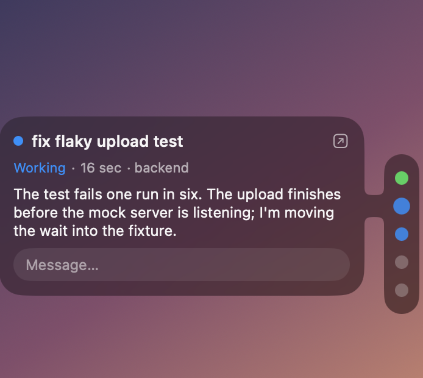
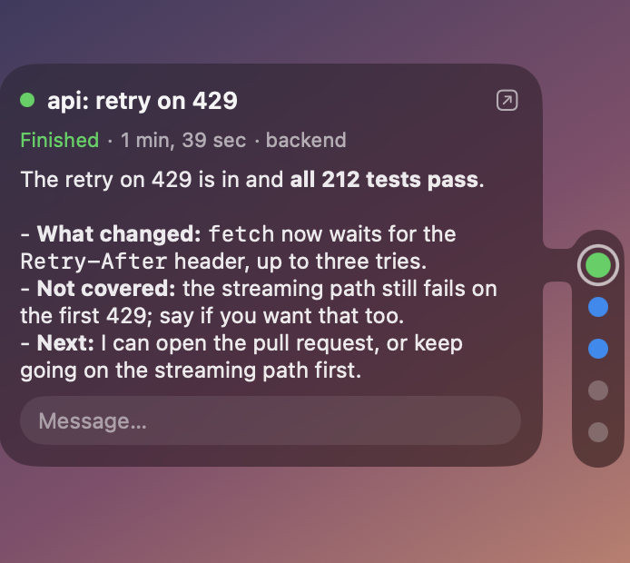
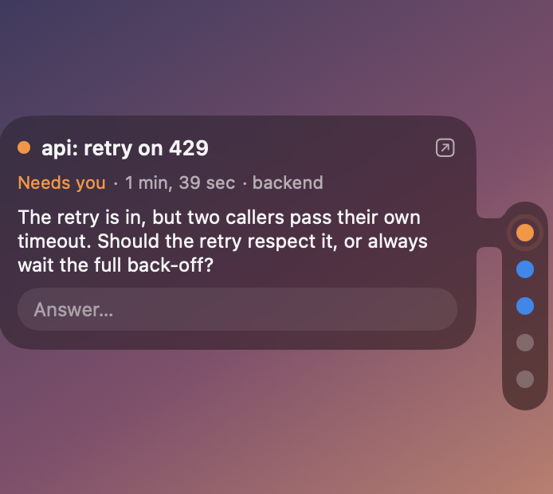

# Agent Dots

A glass strip on the edge of the screen with one dot for each agent session running in
[cmux](https://cmux.com). It floats over every window and Space, so you can see who is working and who is
waiting for you without switching to the terminal.

| Rest the pointer on a dot | Click a dot: the whole answer stays | An agent asks: its card opens by itself |
| --- | --- | --- |
|  |  |  |

The pictures use made-up sessions on a plain backdrop (`AGENTDOTS_DEMO=hover|pinned|ask`).

- **Blue, breathing:** working. **Amber, ringing:** needs you. **Green:** finished, not looked at yet.
  **Grey:** idle.
- **Only what is recent:** a session keeps its dot for ten minutes after it last said or did anything. One
  that is working or needs you always has its dot; a finished or idle one that has been quiet longer goes,
  and comes back when it speaks again.
- **Rest the pointer on a dot** and it shows its card: the session's name, its state, how long it has been
  in it, its workspace, and the last thing the agent said.
- **A card pours out of its dot:** a neck of the same glass joins the strip to the card at the dot's level,
  the card's middle sits level with the dot, and it slides from dot to dot as the pointer moves.
- **Click a dot, or its card** and the card stays open with everything the agent said, until you click anywhere else
  (or press Escape).
- **When an agent asks something**, its card opens by itself beside its dot, with the question.
- **Answer from the card:** type in it and press Return. The message goes through `cmux agent message`,
  which hands it to the agent through its hooks, and the card says what became of it: delivered, or queued
  until the agent's turn ends. cmux can no longer wake a session that has been idle for a day, so when a
  message to an idle session is still queued after four seconds, its pane is given a one-line prompt that
  makes cmux hand it over (never into a half-typed prompt or an open question).
- **The arrow on a card** opens that session's pane in cmux.
- **Right-click the strip:** move it to the other edge, open at login, quit.

The glass is the system's own (macOS 26 Liquid Glass), with no colour or opacity of its own: it follows
light and dark, the Clear or Tinted glass setting, and Reduce Transparency. It turns light over a light window
and dark over a dark one by itself, within half a second, without waiting for the pointer.

## What it reads

It installs no hook and changes no setting. It reads:

- one small state file a pane under `~/.cache/cmux-status/<workspace>/<pane>`, holding `running`, `waiting`,
  `done` or `ready`. **These are written by a Claude Code hook script of your own**, not by cmux itself: call
  one from your `PreToolUse` / `Notification` / `Stop` / `SessionEnd` hooks that writes the state for
  `$CMUX_WORKSPACE_ID` and `$CMUX_PANEL_ID`. Without those files the strip shows a single idle dot;
- the pane titles, from `cmux tree`;
- the last thing each Claude Code session said, from the end of its transcript under `~/.claude/projects/`
  (`claude agents --json` says which session runs in which pane).

## Build

    sh build.sh

Needs macOS 26 and Xcode's Swift. The script builds the app, signs it for this Mac only, and puts it in
`/Applications/Agent Dots.app`.
